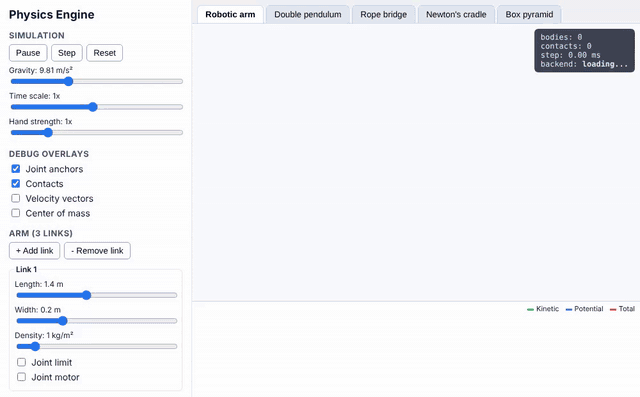

# Physics-Engine

A 2D rigid-body physics engine written in C++17 and compiled to WebAssembly, with an
interactive demo that runs entirely in your browser.

**[Live demo: physicsenginethai.vercel.app](https://physicsenginethai.vercel.app)**



## What it does
The engine simulates bodies, joints and collisions in real time. The demo lets you poke at it:

- **Robotic arm:** a base with 1 to 8 links on revolute joints. Change each link's length, width
  and density, and give each joint an angle limit or a motor.
- **Scene gallery:** a double pendulum with a trail, a rope bridge, Newton's cradle and a box pyramid.
- **Grab and throw:** drag any body with the mouse. The **Hand strength** slider sets how hard the
  hand can pull.
- **Gravity and time:** change gravity and slow time down or speed it up.
- **Debug views:** joint anchors, contact points, velocity vectors and centre of mass.
- **Energy chart:** live kinetic, potential and total energy, a quick check that the simulation is sound.
- **Shareable:** the page address holds your setup, so you can send someone a link to it.

Under the hood: semi-implicit Euler integration at a fixed 120 Hz step, a sequential-impulse
constraint solver (joints and contacts), circle and convex-polygon collision with friction and
restitution, and a sort-and-sweep broadphase. See [docs/PLAN.md](docs/PLAN.md) for the design.

## Layout
`engine/` (C++17 core, namespace `physics`), `bindings/` (Emscripten embind),
`web/` (Next.js demo), `scripts/`, `docs/PLAN.md`.

## Native build and tests
```sh
cmake --preset native          # Debug, tests on, -Wall -Wextra -Wpedantic -Werror
cmake --build --preset native -j
ctest --preset native
```

## WebAssembly
Requires [emsdk](https://github.com/emscripten-core/emsdk) (CI pins 3.1.74):
```sh
git clone https://github.com/emscripten-core/emsdk && cd emsdk
./emsdk install 3.1.74 && ./emsdk activate 3.1.74 && source ./emsdk_env.sh
cd /path/to/Physics-Engine && scripts/build-wasm.sh
```
This builds the `wasm` preset and copies `engine.js` + `engine.wasm` to
`web/public/wasm/`. Commit them: CI rebuilds and fails if they differ. Without
them the web app falls back to its TypeScript mock engine.

## Web demo
```sh
cd web
npm ci
npm run dev      # http://localhost:3000
npm run lint && npm test && npm run build   # static export to web/out
```

## Deploy (Vercel)
Import the repo at its root; `vercel.json` sets the build (`cd web && npm ci && npm run build`)
and output (`web/out`), and serves `/wasm/*.wasm` as `application/wasm`. Preview
deploys run per PR, production on `main`. The committed wasm files are deployed
as-is; Vercel does not build C++.
